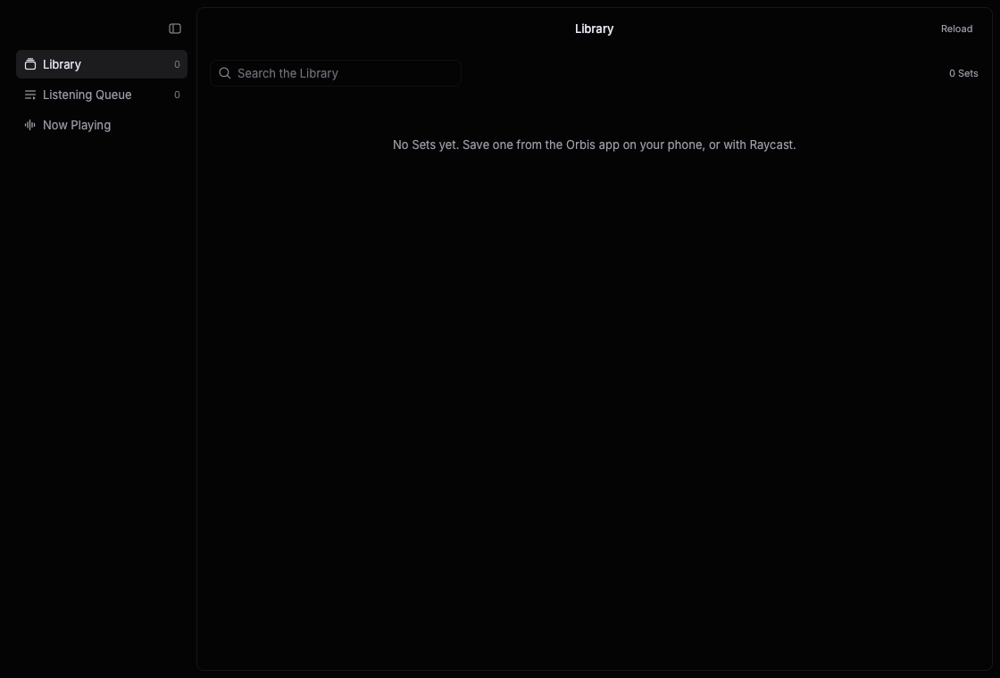
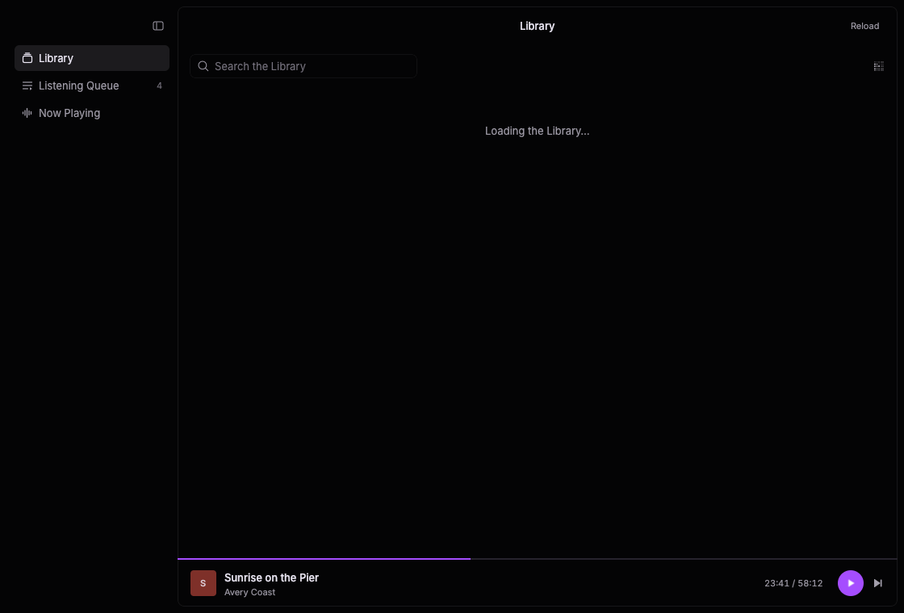
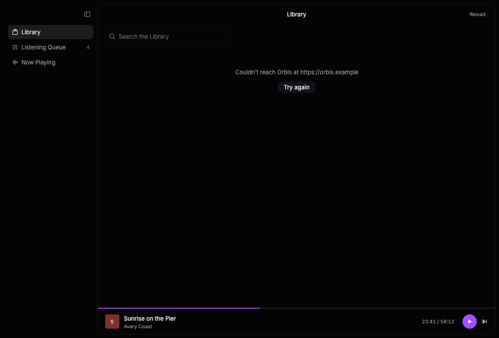
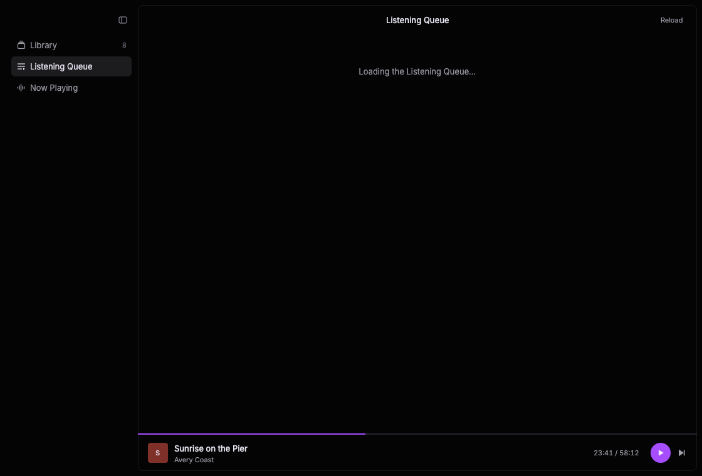
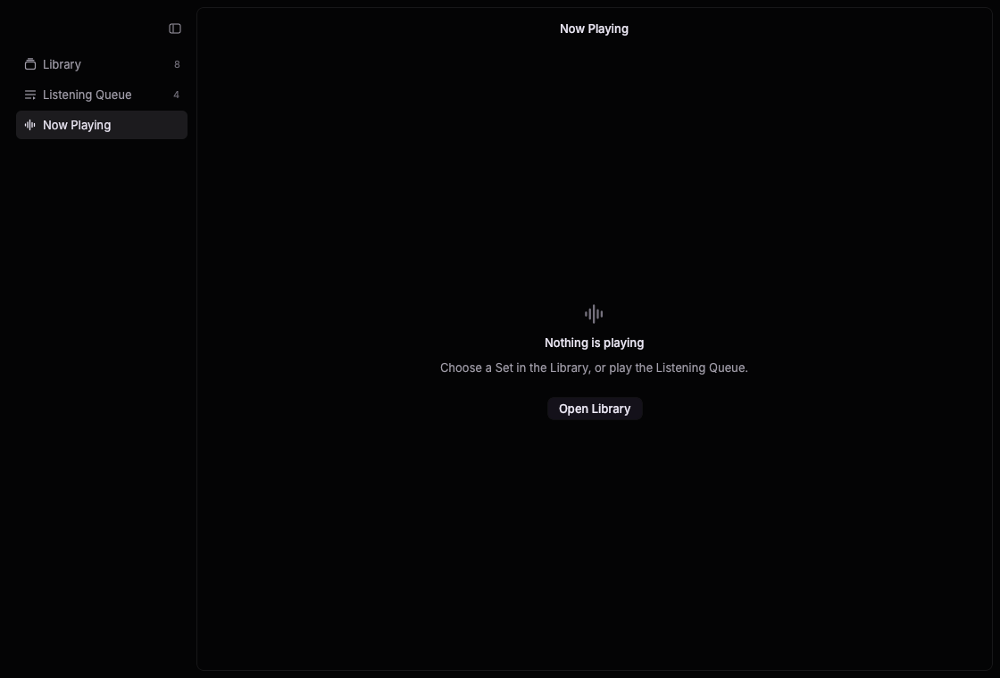
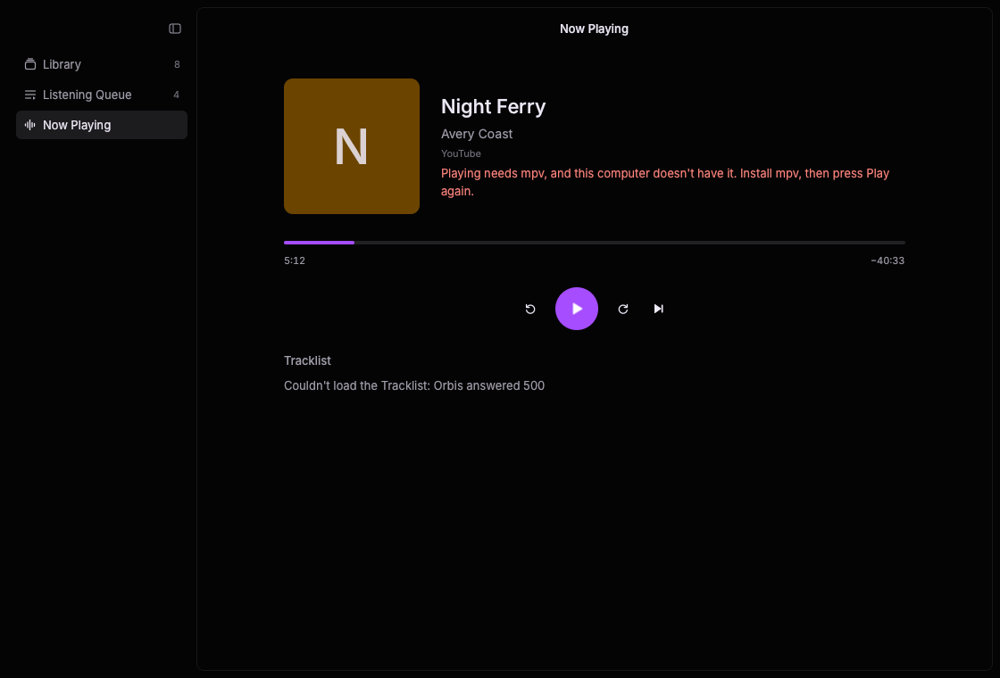
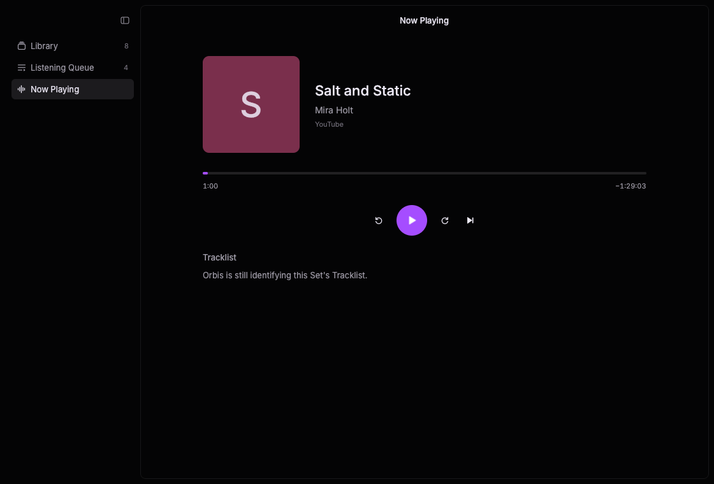
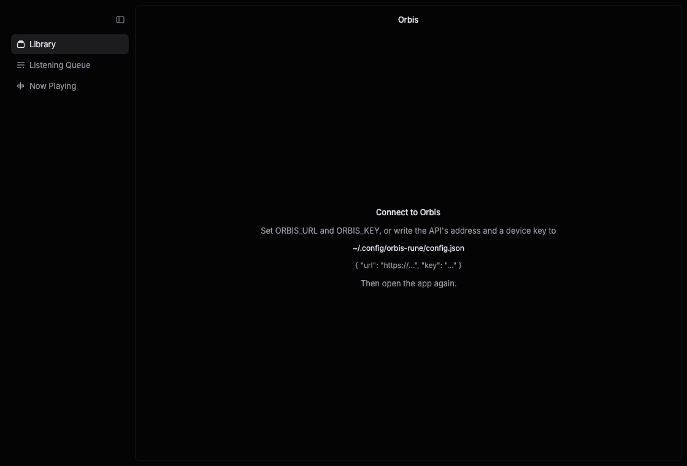
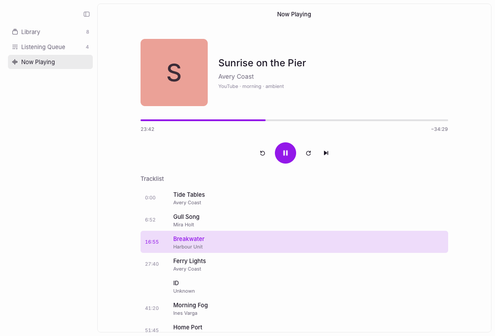

# Orbis for the desktop (Rune)

A desktop client for Orbis, built with [Rune](https://github.com/anomalyco/rune), a GPU-drawn Rust UI framework. It shows the person's Library and Listening Queue, plays a Set's Retained Audio, keeps the Playback Position, and moves through the queue as each Set ends. It talks to the same API as the other clients (`packages/contracts/src/http-api.ts`).

It started from the `rune-app` skill's template and pins Rune `268ac7c`, the rev the template pins.


## Run it

Requires Rust (the toolchain in `apps/rune/rust-toolchain.toml` installs itself through rustup) and, on Linux, the `libxkbcommon` and `wayland` development files. Sound needs `mpv` on `PATH`.

```sh
cd apps/rune
cargo run                                   # the window, against the API in ORBIS_URL / ORBIS_KEY
ORBIS_RUNE_DEMO=1 cargo run                 # the window on made-up data; nothing goes out
cargo run -- --snap out.png --scene playing --at 1.5    # one scene, headless
cargo run -- --list-scenes
```

The app reads the API's address and a device key from `ORBIS_URL` and `ORBIS_KEY`, else from `$XDG_CONFIG_HOME/orbis-rune/config.json`:

```json
{ "url": "https://orbis.example", "key": "<a device key>" }
```

With neither, it shows how to add them (the `signed-out` scene).

### Against a stand-in Orbis

`apps/rune/scripts/stand-in` starts the repo's disposable fixture server (`scripts/fixture.ts`) with four made-up Sets, three with Retained Audio made from four minutes of silence, and two of them in the queue. It prints the command that opens the window against it, and removes its data when it stops. It needs `bun`, `ffmpeg`, and a built contracts package (`bun run --filter @orbis/contracts build`).

## What it does

### Library

Every Set the person saved, in the server's order. The search field filters by title, creator and Tag as the person types. Pressing a Set plays it. Under the pointer or keyboard focus, a playable Set offers Play Next and Add to Queue. A Set without Retained Audio says why it can't play, and offers Download when Orbis can make one; while a Download runs, the Library reloads every 10 s. An Apple Music Set plays only in the Apple apps, so this app marks it and doesn't play it.

Scenes: `library`, `library-search`, `library-empty`, `library-loading`, `library-failed`, `library-long`, `toast`.

### Listening Queue

The active Set, then Up next, then any Sets earlier in the queue. Pressing a Set plays it and keeps the rest of the queue (ADR 0001). The screen reloads each time it opens, because the person's other devices share the queue.

Scenes: `queue`, `queue-empty`, `queue-loading`, `queue-failed`.

### Now Playing and the bar

Pressing Play makes the Set the queue's active one and streams it through a stream grant (ADR 0007). Now Playing shows the Set, a bar to press or drag to a place, Back 15 s, Play and Pause, Ahead 30 s and Next, and the Tracklist with the Cue playing now; pressing a Cue with a start time goes there. The other screens show the same Set in a bar at the foot.

The app saves the place every 15 s while a Set plays, on pause and when another Set starts. When a Set plays out, the app resets its place, tells Orbis it finished, and plays the next Set; at the end of the queue it stops. Closing the window stops the sound.

Scenes: `playing`, `playing-empty`, `playing-loading`, `playing-failed`, `playing-no-tracklist`, `playing-long`.

### Keys

| Key                    | Does                                  |
| ---------------------- | ------------------------------------- |
| Space                  | Play and pause                        |
| Ctrl+1, Ctrl+2, Ctrl+3 | Library, Listening Queue, Now Playing |
| Ctrl+R                 | Reload the screen                     |
| Ctrl+Shift+B           | Show and hide the sidebar             |

### Not yet

Artwork (each Set shows a coloured square with its first letter), Playlists, Tags editing, saving a Set, signing in with a Sign-in Code, Presence, live queue updates from `/events`, and playback reports. Sound plays through mpv on every platform; Rune's own `Player` has no Linux backend at this rev.

## Check it

```sh
scripts/check                                       # format, code shape, clippy, tests and goldens
ORBIS_RUNE_UPDATE_GOLDENS=1 cargo test goldens       # rewrite goldens after a change you meant
```

`apps/rune/src/goldens.rs` renders every scene into `apps/rune/goldens/<scene>.txt` and fails on any difference. Its press tests drive the real view, answer the API from `api::fixture`, and check what the app sent and what it then shows. `bun run check` at the repo root runs `apps/rune/scripts/check` as this package's `test` task.

## Scenes

Each still is `cargo run -- --snap shots/<scene>.png --scene <scene> --size 1120x760 --scale 1 --at 1.5`, on made-up data.

|  |  |
| --- | --- |
|  `library` |  `library`, pointer on Night Ferry |
|  `library-search` |  `library-long` |
|  `library-empty` |  `library-loading` |
|  `library-failed` |  `toast` |
|  `queue` |  `queue-empty` |
|  `queue-loading` |  `queue-failed` |
|  `playing` |  `playing-empty` |
|  `playing-loading` |  `playing-failed` |
|  `playing-no-tracklist` |  `playing-long` |
|  `signed-out` |  `library`, light |
|  `playing`, light |  |
