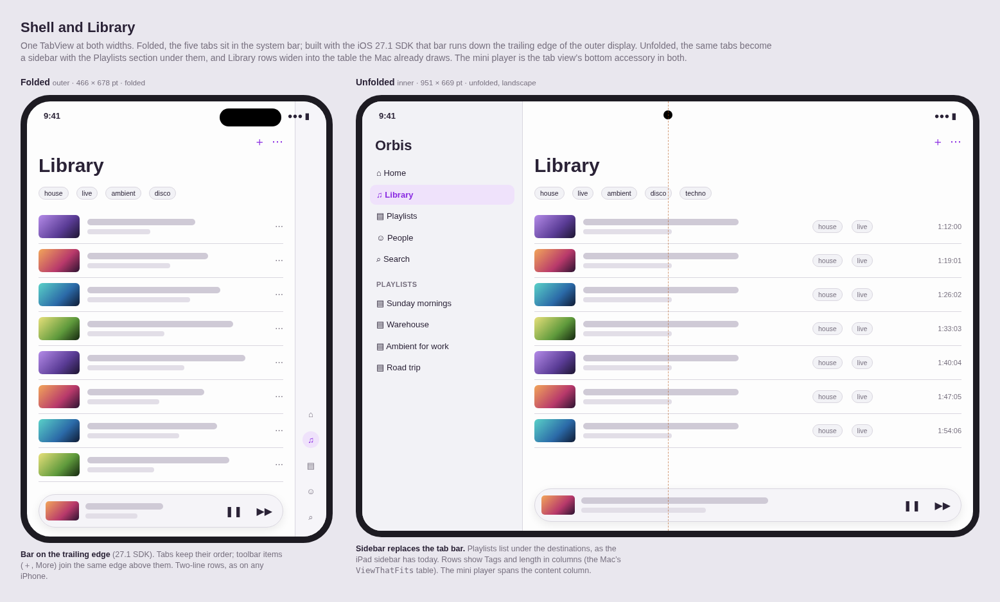
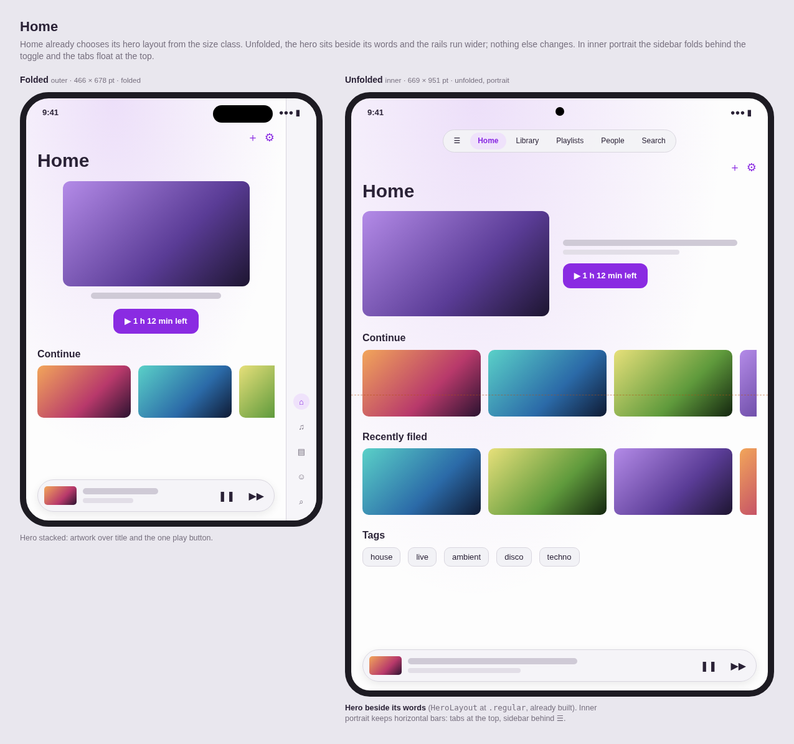
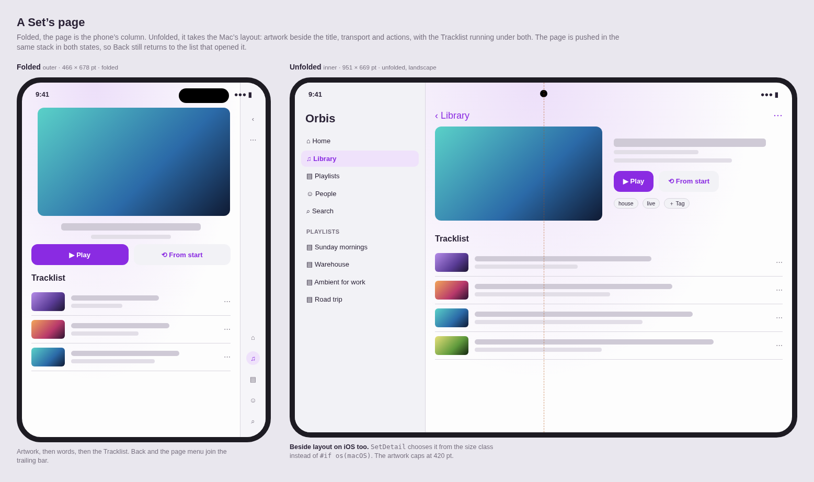
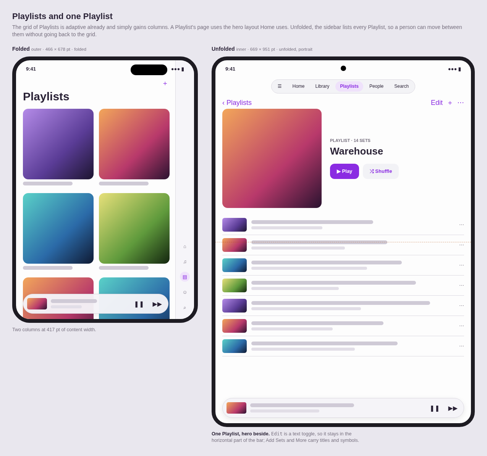
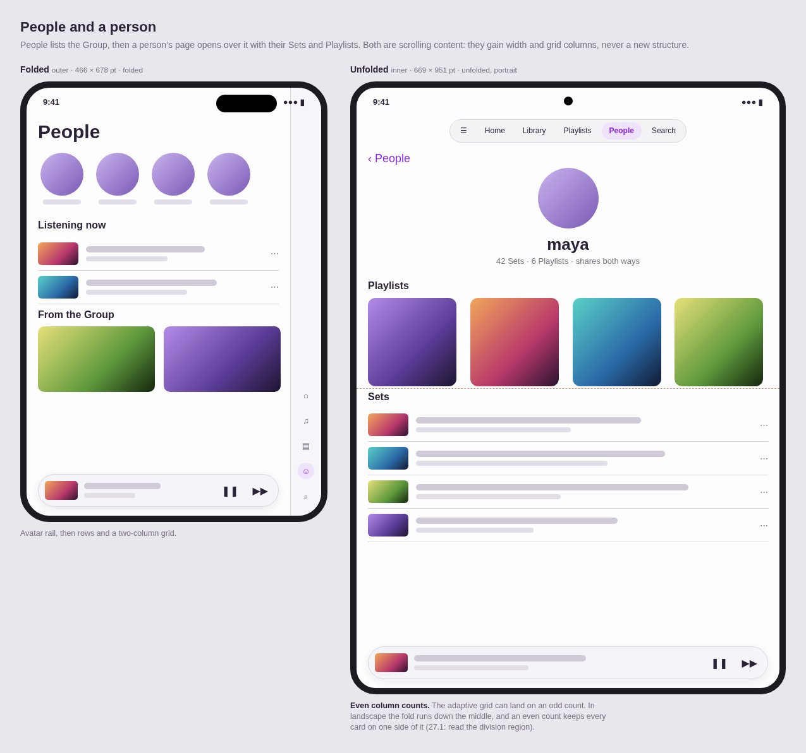
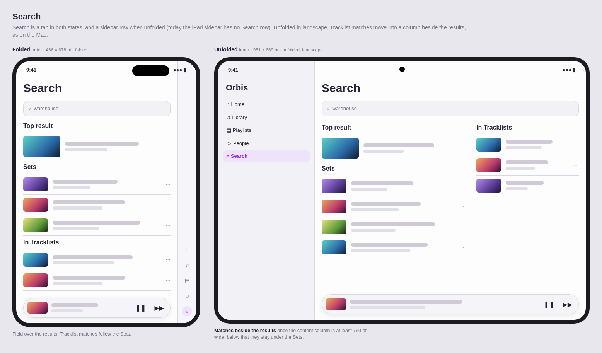
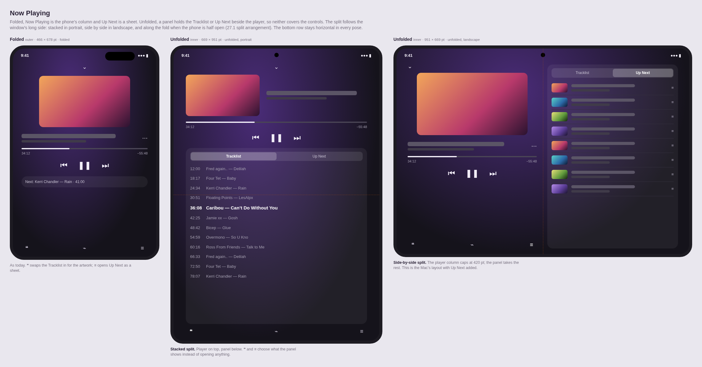
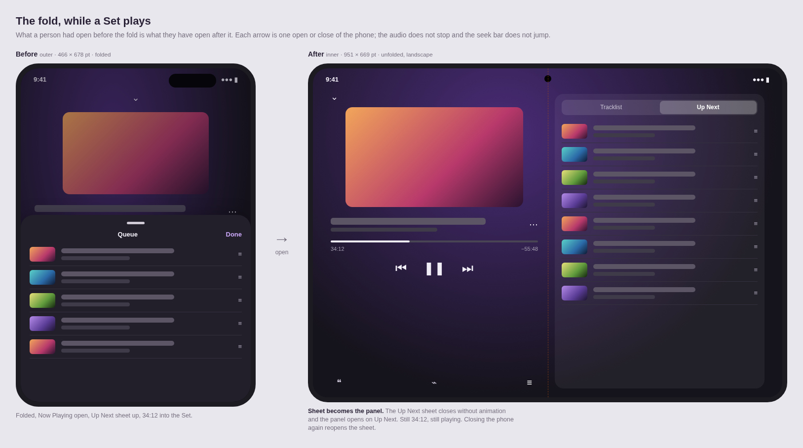
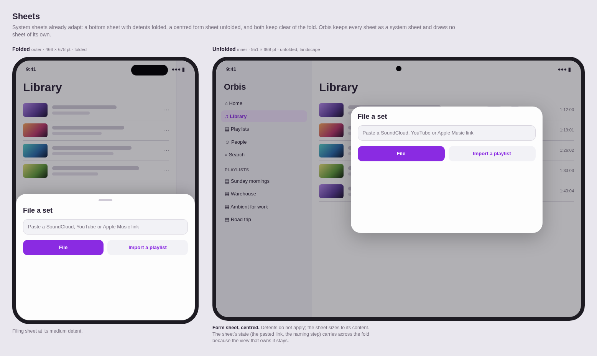

# Orbis on iPhone Duo

The iOS layouts for iPhone Duo: folded, unfolded, and the change between them while the app runs. PAL-1796 is this design; PAL-1795 builds it. tvOS and macOS are out of scope. Code that iOS shares with them must keep working for them.

## The device, in Orbis's terms

| Pose | Points | Horizontal size class | Bars (built with the iOS 27.1 SDK) |
| --- | --- | --- | --- |
| Folded, outer display, portrait | 466 × 678 | `.compact` | Vertical, down the trailing edge |
| Folded, outer display, landscape | 678 × 466 | `.compact` | Vertical |
| Unfolded, inner display, portrait | 669 × 951 | `.regular` | Horizontal |
| Unfolded, inner display, landscape | 951 × 669 | `.regular` | Vertical, in the detail column only |
| Unfolded, one half of Split View | about 475 wide | `.compact` | Vertical, on the app's outer edge |

Sizes come from Apple's simulator captures: 1398 × 2034 px and 2007 × 2853 px, both at 3x. The inner display is two outer displays joined along their long side, so the fold crosses it in portrait and runs down it in landscape. Size classes and bar behavior come from the Axiom `axiom-swiftui` skill (`iphone-duo.md`), which cites Apple's tech talks 111461 to 111466 and its own measurements on the 27.1 Duo simulator.

Four facts shape the design:

- Duo is still an iPhone. Orbis keys layout to the size class and to the space it is given, never to the device model or the display.
- People open and close the phone mid-task. The hierarchy is the same inside and out, and what was on screen before the fold is on screen after it.
- System containers (`TabView`, `NavigationStack`, sheets, menus) already avoid the fold and move their bars to the side. Orbis uses them and draws no bar or sheet of its own.
- The build lanes use Xcode 27.0 (Cortex reports `Xcode 27.0, 27A266a` and the iOS 27.0 runtime only). A 27.0 build gets no vertical bars and none of the 27.1 APIs below. Every 27.1 call needs `@available(iOS 27.1, *)`, and the iOS 26.1 deployment target keeps the path without it.

## Rules for every screen

1. **One view tree at every width.** The root never swaps one container type for another when the size class changes. A branch on width chooses a leaf layout (`AnyLayout`, `ViewThatFits`), so view identity, and the `@State` it holds, survives the fold.
2. **Navigation lives in the model.** `AppModel.destination`, `openedSets`, `openedPlaylistId` and the open person already do. Two more move there: whether Now Playing is open, and what its panel shows.
3. **Playback never notices the fold.** `AudioPlayer` belongs to `AppModel`, not to a view, so a fold must not pause, reload or seek it. The seek bar reads the player, so it shows the same time before and after.
4. **Scroll position carries across.** A list that keeps its identity keeps its offset. Where row height changes with width (Library's two-line rows against its table rows), the list anchors on the first visible Set with `scrollPosition(id:)`, held above the branch.
5. **No animation of our own on a resize.** The system animates the window. A custom move that is running when the window changes size, such as the player growing out of the mini player, ends at its target without animation.
6. **Displace, never hide.** Every action is reachable in every pose. Scrolling content does not move away from the fold, because it adapts by scrolling.
7. **Bar items carry a title and a symbol.** A toolbar `Button` or `Menu` uses a `Label`, so it can join a vertical bar and read correctly in the overflow menu. A text toggle (`EditButton`, Select and Done) stays horizontal: with the 27.1 SDK, mark it `.axisBehavior(.horizontalOnly)`.
8. **Insets are per side.** The vertical bar makes the leading and trailing safe-area insets differ, and the side changes between the two halves of Split View. Content pads inside the safe area; backgrounds alone ignore it.

## Screens

The wireframes are drawn at the Duo's point sizes. The dashed line is the fold. Their source is [`iphone-duo/wireframes.html`](iphone-duo/wireframes.html); `sh docs/design/iphone-duo/render.sh` renders the PNGs again.

### Shell and Library

|  | Folded | Unfolded |
| --- | --- | --- |
| Shell | `TabView` with five tabs: Home, Library, Playlists, People, Search. The 27.1 SDK puts the bar on the trailing edge. | The same `TabView` as a sidebar: the five destinations, then a Playlists section. In portrait the sidebar sits behind its toggle and the tabs float at the top. |
| Library rows | Two lines: title, then creator and length. | The table the Mac draws: title, Tags, length, through `SetRow`'s existing `ViewThatFits`. |
| Mini player | The tab view's bottom accessory. | The same accessory, across the content column. |

**What changes:** the tab bar becomes a sidebar, and Library rows gain columns.

**What stays:** the destinations and their order, each tab's navigation stack, the open Set, the Library filters, selection mode, and the scroll anchor.

**Build notes.** Use `.tabViewStyle(.sidebarAdaptable)` and a `TabSection` for Playlists. Gate `.defaultTabBarPlacement(.sidebar)` at `@available(iOS 27, *)` so the inner display opens on the sidebar; iPadOS adapts by itself. iPad gets this shell too, which replaces today's iOS `SidebarShell`. macOS keeps `SidebarShell`.

### Home

Folded, the hero is stacked: artwork, title, then the one play button. Unfolded, `HeroLayout` puts the artwork beside the words. It already chooses from the size class, so Home needs nothing beyond the shell. The rails gain width and show more cards.

### A Set's page

Folded, the page is today's column. Unfolded, it uses the Mac's layout: artwork (at most 420 pt) beside the title, transport and actions, and the Tracklist under both. `SetDetail` chooses that layout from the size class instead of `#if os(macOS)`. The page is pushed onto the same stack in both states, so Back returns to the list that opened it, and a fold keeps the page open.

### Playlists and one Playlist

The Playlists grid is adaptive and gains columns. A Playlist's page uses the hero layout, as Home does. Unfolded, the sidebar lists every Playlist, so a person moves between them without going back to the grid. In the toolbar, Edit stays horizontal (rule 7), and Add Sets and More carry a title and a symbol.

### People and a person

People and a person's page are scrolling content: they gain width and grid columns, never a new structure. The three adaptive grids (People, a person's Playlists, Home's Tags) choose an even column count when unfolded in landscape, so no card straddles the fold. With 27.1, read the division region; without it, choose an even count on `.regular` width in landscape.

### Search

Search is a tab when folded and a sidebar row when unfolded. Today the iPad sidebar has no Search row. When the content column is at least 760 pt wide, Tracklist matches move into a 280 pt column beside the results, as on the Mac. Below that width they stay under the Sets. The query and the results carry across the fold.

### Now Playing, the queue and the mini player

|  | Folded | Unfolded, portrait | Unfolded, landscape |
| --- | --- | --- | --- |
| Layout | Today's column | Player above, panel below | Player left (at most 420 pt), panel right |
| Tracklist | Replaces the artwork | Panel, Tracklist segment | Panel, Tracklist segment |
| Up Next | Sheet | Panel, Up Next segment | Panel, Up Next segment |
| Bottom row | Tracklist, AirPlay, Up Next | The same buttons choose the panel's segment | The same |

The split follows the window's long side, which is the 27.1 split arrangement's default: stacked in portrait, side by side in landscape, and along the fold when the phone is half open. Without 27.1, an `AnyLayout` chooses `VStackLayout` or `HStackLayout` from the space Now Playing is given (`onGeometryChange`), not from the device. Unfolded, the panel shows the Tracklist when the Set has cues, and otherwise Up Next.

Now Playing keeps its own close chevron and a horizontal bottom row in every pose. It is one bottom-heavy page drawn over the shell, the case Apple names for keeping bars horizontal. Its content stays inside the safe area, so the trailing bar's inset is respected when folded.

The mini player is the tab view's bottom accessory at both widths. The player grows out of it at both widths too (`NowPlayingExpansion`). The full-screen cover with the system zoom stays for macOS only.

### The fold, while a Set plays

| On screen before | Open the phone | Close the phone |
| --- | --- | --- |
| A list, scrolled | The same list, the same top row | The same list, the same top row |
| A Set's page | The same page, in the beside layout | The same page, in the column |
| Now Playing | Now Playing, in the split | Now Playing, in the column |
| Now Playing with the Tracklist in place of the artwork | Panel on Tracklist, artwork back | Tracklist in place of the artwork |
| Now Playing with Up Next as a sheet | The sheet closes without animation; the panel opens on Up Next | The panel's Up Next becomes the sheet again |
| Any other sheet (filing, Tags, rename, Settings) | The same sheet as a centred form sheet, with its draft | A bottom sheet, with its draft |
| A confirmation dialog | Stays open | Stays open |

The Set plays on throughout: same Set, same time, no pause.

### Sheets

Every sheet stays a system sheet. Folded, a sheet is a bottom sheet with its detents. Unfolded, it is a centred form sheet that sizes to its content and keeps clear of the fold. With the 27.1 SDK, a sheet's toolbar on the outer display goes vertical. Queue's Done is text, so it stays horizontal. The Queue sheet is reached only when folded, because unfolded the queue is the Now Playing panel.

### Screens that need no change

- **Sign in and pairing** (`SignInView`): a centred column at most 360 pt wide, which suits both displays. Nothing scrolls under a bar.
- **Splash**: fills the window from a `GeometryReader`, so it fits any size, and it lasts one launch.
- **Settings**: a system sheet (see Sheets).

## Audit

`rg` over `apps/apple/Orbis` and `OrbisDesign/Sources` (excluding `TV/`) finds no `UIScreen.main`, no `userInterfaceIdiom`, and no interface-orientation reads. Every problem below comes from the size-class switch, from layouts gated on `os(macOS)` that a wide iPhone also needs, or from a fixed size.

| # | Where | Problem | Fix |
| --- | --- | --- | --- |
| 1 | `Orbis/OrbisApp.swift:146` | `RootView` swaps `CompactShell` for `SidebarShell` when `horizontalSizeClass` changes. A fold rebuilds the whole tree: open Now Playing closes, sheets close, Library selection mode ends, and every scroll position resets. | One `.sidebarAdaptable` `TabView` on iOS at every width (Shell). `SidebarShell` stays for macOS. |
| 2 | `Orbis/RootView.swift:26`, `:126` | Whether Now Playing is open is `@State` in each shell, so it does not survive a shell swap. | Move it to `AppModel`, as `destination` is. |
| 3 | `Orbis/RootView.swift:179`, `Orbis/AppModel.swift:2480` | The iOS sidebar lists `Destination.shellCases`, which drops Search. When unfolded, Search has no row; a person who unfolds on Search cannot return to it. | Search is a tab at every width (Search). |
| 4 | `Orbis/RootView.swift:224` | `.id(model.destination)` gives the wide layout one stack for all destinations. A change of destination throws away the last one's scroll position and pushed page, which the phone's tabs keep. | Each tab owns its stack (fix 1). |
| 5 | `Orbis/RootView.swift:225`-`231` | Wide, the mini player is a hand-made `safeAreaBar` at most 560 pt wide; narrow, it is the tab view's bottom accessory. Two views, so it jumps on a fold, and the hand-made bar gets no system placement around the vertical bar. | The bottom accessory at both widths (Now Playing). |
| 6 | `Orbis/RootView.swift:235`-`242`, `Orbis/OrbisApp.swift:312` | Wide, Now Playing is a `fullScreenCover` with the system zoom; narrow, the `NowPlayingExpansion` overlay at `Orbis/RootView.swift:61`. A fold while it is open dismisses one and opens neither. | `NowPlayingExpansion` at both widths; the cover stays for macOS. |
| 7 | `Orbis/NowPlayingExpansion.swift:57` | `screenRadius = 55` assumes a display's corner radius. Duo's displays have their own corners. | `ConcentricRectangle` (iOS 26), which follows the display. |
| 8 | `Orbis/NowPlayingExpansion.swift:40`, `:50`, `:135`, `:190`-`:197` | The move from the bar reads `barFrame` and `screen` in global coordinates when it starts. A resize mid-move animates to frames that no longer exist. | On a size change while `isMoving`, set the end state without animation (rule 5). |
| 9 | `Orbis/NowPlayingScreen.swift:93`-`106` | The player beside its Tracklist is `#if os(macOS)`. A wide iPhone gets the phone column, half the width unused, with the Tracklist covering the artwork. | The split layout (Now Playing), chosen from the space given. |
| 10 | `Orbis/NowPlayingScreen.swift:55`-`58` | Up Next is a sheet at every width. Unfolded, a form sheet covers the player's controls. | Up Next is a panel segment when unfolded, and the sheet when folded. |
| 11 | `Orbis/NowPlayingScreen.swift:78` | The artwork is fixed at 296 pt, three quarters of a 390 pt phone. In a 420 pt player column it is small. | Three quarters of the player column, at most 420 pt. |
| 12 | `OrbisDesign/Sources/OrbisDesign/Components/SetDetail.swift:147`-`183` | The beside layout is `#if os(macOS)`. Unfolded, the artwork is about 610 pt wide and fills the first screen. | Choose the beside layout from the size class (A Set's page). |
| 13 | `OrbisDesign/Sources/OrbisDesign/Components/SetRow.swift:155`-`173` | The table row (title, Tags, length) is `#if os(macOS)`. Wide iPhone rows are two lines with empty space beside them. | Use the `ViewThatFits` table on iOS too; it falls back to two lines where it does not fit. |
| 14 | `Orbis/RootView.swift:1246`-`1258` | Search's Tracklist-matches column is `#if os(macOS)`, fixed at 400 pt. | Beside the results at a content width of 760 pt or more, 280 pt wide (Search). |
| 15 | `Orbis/RootView.swift:942`, `Orbis/PlaylistViews.swift:133`, `Orbis/PeopleDestination.swift:568` | `GridItem(.adaptive(minimum: 160))` can choose an odd column count, which puts a card across the fold in landscape. | An even count when unfolded in landscape; with 27.1, from the division region (People). |
| 16 | `Orbis/RootView.swift:730` | Library's Select becomes a text-only Done. With the 27.1 SDK an item that changes between a symbol and text belongs on the horizontal axis. | `.axisBehavior(.horizontalOnly)` on the item, gated at 27.1. |
| 17 | `Orbis/RootView.swift:699`-`726` | Library's own More (`ellipsis.circle`) menu sits beside the system's overflow button in a vertical bar, so two ellipses can show. | With 27.1, give Play playlist, Select and Sort their own toolbar items at a low `visibilityPriority`, so the system overflow holds them. Until then, keep More. |
| 18 | `Orbis/Info.plist` (`UIApplicationSupportsMultipleScenes`) | Duo's inner display can open a second window of an app that sets this key, and Orbis sets it for CarPlay. Both windows share `OrbisSession.model`, so they show the same destination, as two iPad windows do today. | No change. Orbis offers no New Window action. A second window mirrors the first, which is acceptable for a one-person app. |

Two checks found nothing to fix:

- The iOS minimum window (`Orbis/OrbisApp.swift:25`, 320 × 320) is smaller than every Duo pose.
- `Orbis/Info.plist` supports landscape on iPhone, which Apple asks for on the outer display. The inner display ignores the list.

## Verification for PAL-1795

The wireframes are drawings, not app screenshots. When this design was written, no host could run the iPhone Duo simulator: Cortex has Xcode 27.0, and the Duo device type needs Xcode 27.1 and the iOS 27.1 runtime. PAL-1795 ends with app screenshots on that simulator. It needs:

- Xcode 27.1 or later and the iOS 27.1 runtime on a lease host (PAL-1798), and the app built against the 27.1 SDK.
- A UI journey that plays a Set, opens Now Playing and Up Next, and changes the pose with `XCUIDevice.shared.hinge` (Xcode 27.3). After each pose change it asserts the same Set, an elapsed time that kept moving, the same open screen, and the same top Library row. It exports a screenshot per pose.
- Screenshots closed, open in both orientations, half open, and in both halves of Split View. Capture the outer display by name: the default capture is the inner display, which is black while the phone is closed.

Two behaviors need the simulator before PAL-1795 relies on them:

- The bottom accessory when the tab view shows its sidebar, and beside a vertical tab bar. If the system does not draw it there, keep one mini player view and place it with `safeAreaBar` in the content column at both widths, so the fold still keeps its identity.
- Whether the inner display in portrait opens with the sidebar or behind its toggle under `.defaultTabBarPlacement(.sidebar)`. Either is acceptable; record which.
